<p align="center">
  
</p>

<h1 align="center">Domus</h1>

<p align="center">
  <em>Design a room, arrange furniture, and explore your space in 3D.</em>
</p>

<p align="center">
  A browser-based room planner for shaping layouts, experimenting with interiors,
  and visualising your ideas.
</p>

---

## How it works

Domus brings room planning into one workspace. Start with a room layout, add
openings, furnish the space, and switch to 3D to explore the result.

> **Current availability:** Domus currently runs locally from its source code.
> There is no downloadable release yet. GitHub Actions checks changes; it does
> not publish an app download.

---


## What you can do

- Draw and edit room layouts in 2D.
- Add doors, windows and openings.
- Place, move and rotate furniture.
- Change room colours, floors and lighting.
- Explore the room in 3D or at eye level.
- Save rooms in your browser or export them as files.

## Quick start

You need **Node.js 24** and **npm 10 or newer**. For 3D views, use a browser
with WebGL2 support. You do not need Blender or private model files to run Domus.

Open a terminal and run:

```bash
git clone https://github.com/8041q/Domus.git
cd Domus
npm ci
npm run build
npm run start:local
```

Then open **http://localhost:5173**. Keep the terminal open while you use Domus.
Press **Ctrl+C** in the terminal to stop it.

If you use [nvm](https://github.com/nvm-sh/nvm), run `nvm install` and `nvm use` in the project folder before `npm ci`.

### Download the source as a ZIP

On GitHub, choose **Code → Download ZIP** and extract the file. Open a terminal in the extracted `Domus` folder and run:

```bash
npm ci
npm run build
npm run start:local
```

## Which command should I use?

| What you want to do | Command |
| --- | --- |
| Install project dependencies | `npm ci` |
| Run the built app for normal use | `npm run build` then `npm run start:local` |
| Work on the code with automatic refresh | `npm run dev` |
| Run unit tests | `npm test` |
| Run all browser tests | `npm run test:e2e` |
| Check types, tests and production build | `npm run check` |

Use `npm run build` again after changing the code before starting the built app.
The dev server runs directly from source, so it does not need a separate build.

**Use `npm run start:local` for this source checkout.** `npm start` is for a prepared public deployment, which is not available as a download.

## Using Domus

1. Choose **Build room** to draw the room and add openings.
2. Choose **Plan room** to add furniture and set finishes.
3. Use **Project → Save** to save in this browser.
4. Use **Project → Export room** to download a portable room file.

Your browser saves stay on this device and browser. Export a room file to keep a backup or move it to another computer.

### Basic controls

| Action | Control |
| --- | --- |
| Undo / redo | Ctrl or Cmd + Z / Y |
| Rotate selected furniture | R |
| Remove selected furniture | Delete or Backspace |
| Orbit the 3D view | Drag with the left mouse button |
| Pan the 3D view | Drag with the right mouse button |
| Zoom | Scroll |

## Optional features

### Interior walls

Interior walls and named spaces are an experimental feature and are off by default. To turn them on in the dev server, run:

```bash
VITE_DOMUS_INTERIOR_WALLS=1 npm run dev
```

To include them in a build, run:

```bash
VITE_DOMUS_INTERIOR_WALLS=1 npm run build
```

### AI assistant

An experimental AI assistant is available when running the local app. Open **Plan room → AI Experimental**. It can suggest furniture changes for you to review. See the [AI guide](docs/AI.md) for setup and API-key information.

## More information

- [Project and file handling](docs/PROJECT_HANDLING.md)
- [Architecture and code structure](docs/ARCHITECTURE.md)
- [AI assistant](docs/AI.md)
- [Preparing furniture models](docs/BLENDER_METADATA.md)
- [Contributing & tests](docs/CONTRIBUTING.md)
- [Hosting a public version](docs/HOSTING.md)
